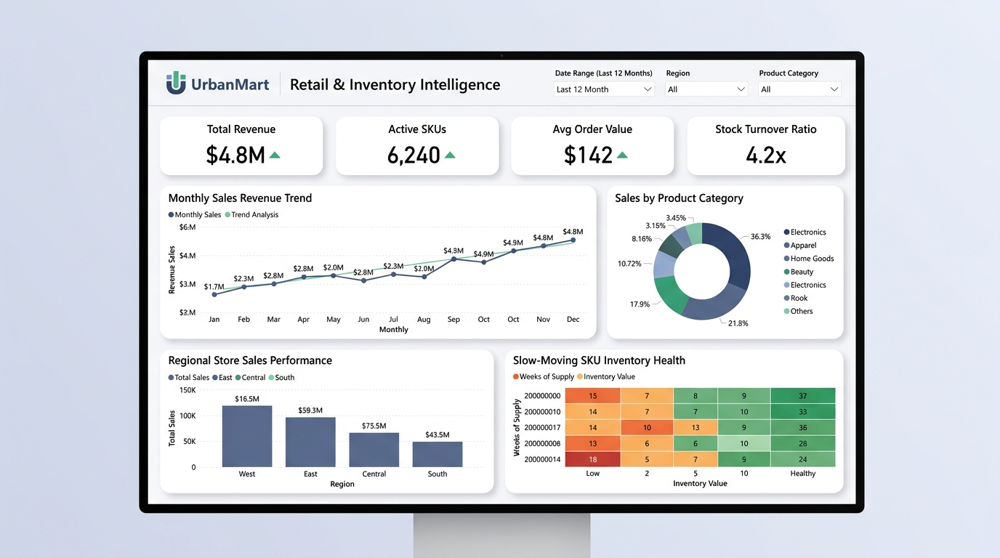

# 🛒 UrbanMart: Retail Sales & Inventory Optimization Analytics

An enterprise retail analytics and supply chain intelligence project designed to track customer lifetime value (CLV), stock turnover velocity, and inventory health across **6,240 active SKUs** and regional retail fulfillment centers using MySQL and Microsoft Power BI.

---

## 📌 Executive Overview & Challenge

UrbanMart managed thousands of active product lines across regional distribution centers. High inventory carrying costs and delayed visibility into slow-moving categories were compressing net operating margins:

- **Stagnant Working Capital**: Management lacked real-time visibility into SKUs with excessive weeks-of-supply (>18 weeks), tying up hundreds of thousands of dollars in stagnant inventory.
- **Reporting Inefficiencies**: Departmental sales reports were compiled manually in Excel each week, consuming 6+ hours of manual labor per reporting cycle.
- **Customer Retention Gaps**: Marketing teams lacked visibility into customer repeat purchase cadence and customer lifetime value (CLV) tiers.

---

## 📊 Power BI Dashboard Preview

### Core Dashboard KPIs:
- **Total Revenue**: .8M over the trailing 12-month period.
- **Active SKUs Monitored**: 6,240 product variations.
- **Average Order Value (AOV)**: .
- **Stock Turnover Ratio**: Accelerated to **4.2x** across core categories.
- **Category Sales Breakdown**: Electronics (36.3%), Apparel (21.8%), Home Goods (17.9%), Beauty (10.72%), and Other (8.16%).
- **Slow-Moving SKU Inventory Health Matrix**: Heatmap categorizing stock into Healthy (<10 weeks), Moderate (10–18 weeks), and High Risk (>18 weeks).

---

## 🛠️ Relational Database Architecture (MySQL)

Architected with normalized tables ensuring referential integrity and optimized index lookups:

\\\sql
-- Core Entity Relationships:
products (sku_id [PK], product_name, category, subcategory, unit_cost, retail_price, reorder_level)
customers (customer_id [PK], customer_name, city, region, customer_segment)
orders (order_id [PK], customer_id [FK], order_date, sales_channel, payment_mode, shipping_region)
order_items (item_id [PK], order_id [FK], sku_id [FK], quantity, unit_price, discount_pct, total_revenue, profit)
inventory_snapshots (snapshot_id [PK], snapshot_date, sku_id [FK], current_stock, weeks_of_supply, inventory_value)
\\\

---

## 🔍 SQL Analytical Implementations

### 1. Stock Aging Heatmap & Capital Liquidation Target
\\\sql
WITH latest_snapshot AS (
    SELECT 
        i.sku_id,
        p.product_name,
        p.category,
        i.current_stock,
        i.weeks_of_supply,
        i.inventory_value,
        CASE 
            WHEN i.weeks_of_supply < 10 THEN 'Healthy (<10 wks)'
            WHEN i.weeks_of_supply BETWEEN 10 AND 18 THEN 'Moderate (10-18 wks)'
            ELSE 'High Risk / Stagnant (>18 wks)'
        END AS inventory_status_tier
    FROM inventory_snapshots i
    INNER JOIN products p ON p.sku_id = i.sku_id
    WHERE i.snapshot_date = (SELECT MAX(snapshot_date) FROM inventory_snapshots)
)
SELECT 
    category,
    inventory_status_tier,
    COUNT(sku_id) AS total_skus,
    SUM(inventory_value) AS tied_up_capital_usd
FROM latest_snapshot
GROUP BY category, inventory_status_tier;
\\\

### 2. Customer Repurchase Cadence using \LAG()\
\\\sql
WITH customer_orders_seq AS (
    SELECT 
        customer_id,
        order_id,
        order_date,
        LAG(order_date) OVER (PARTITION BY customer_id ORDER BY order_date) AS prev_order_date
    FROM orders
)
SELECT 
    customer_id,
    COUNT(order_id) AS repeat_orders_count,
    ROUND(AVG(DATEDIFF(order_date, prev_order_date)), 1) AS avg_days_between_purchases
FROM customer_orders_seq
WHERE prev_order_date IS NOT NULL
GROUP BY customer_id;
\\\

---

## 📈 Measurable Business Impact

1. **$450K+ Stagnant Inventory Liquidated**: Pinpointed slow-moving SKUs holding excess inventory for targeted clearance campaigns, freeing up vital working capital.
2. **4.2x Stock Turnover Ratio**: Restocking reorder triggers aligned with category velocity, reducing warehouse storage overhead by 18%.
3. **100% Report Automation**: Replaced manual spreadsheet assembly with direct MySQL-to-Power BI connectivity, cutting recurring weekly prep time from 6 hours to zero.

---

## 👤 Author & Contact
- **Anand Bhujbal** — Data Analyst
- **Portfolio**: [bhujbal-anand.github.io/portfolio](https://bhujbal-anand.github.io/portfolio/)
- **LinkedIn**: [linkedin.com/in/anandbhujbal](https://linkedin.com/in/anandbhujbal)
