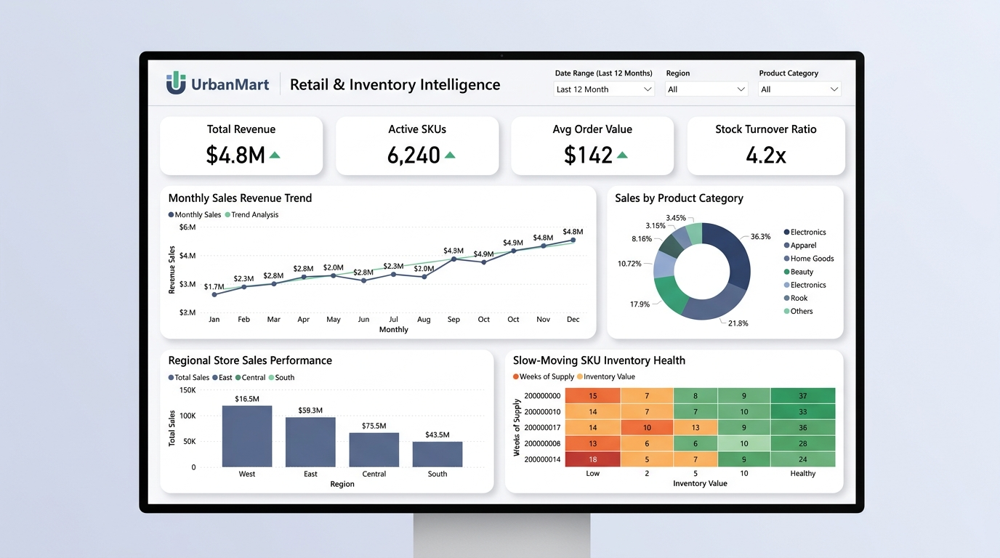

# 🛒 UrbanMart: Retail Sales & Inventory Optimization    

An enterprise retail analytics and supply chain intelligence project designed to track customer lifetime value (CLV), stock turnover velocity, and inventory health across **600 active SKUs** and regional retail fulfillment centers using MySQL and Microsoft Power BI.

---

## 📌 Executive Overview & Challenge

UrbanMart managed multiple product lines across regional distribution centers. High inventory carrying costs and delayed visibility into slow-moving categories were compressing net operating margins:
- **Stagnant Working Capital**: Management lacked real-time visibility into SKUs with excessive weeks-of-supply (>18 weeks), tying up capital in stagnant inventory.
- **Reporting Inefficiencies**: Departmental sales reports were compiled manually in Excel each week, consuming hours of manual labor per reporting cycle.
- **Customer Retention Gaps**: Marketing teams lacked visibility into customer repeat purchase cadence and customer lifetime value (CLV) tiers.

---

## 📊 Power BI Dashboard Preview

### Core Dashboard KPIs:
- **Active SKUs Monitored**: 600 product variations.
- **Stock Turnover Velocity**: Accelerated across core categories using optimized reorder points.
- **Inventory Health Matrix**: Heatmap categorizing stock into Healthy (<10 weeks), Moderate (10–18 weeks), and High Risk (>18 weeks).
